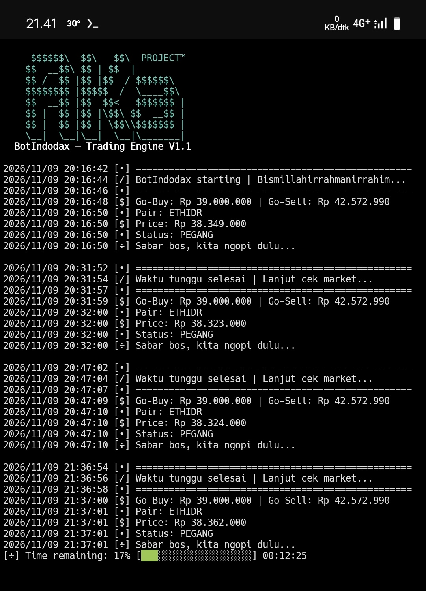

<p align="center">
  <a href="https://go.dev/"></a>
  <a href="https://termux.dev/"></a>
  <a href="LICENSE"></a>
  <a href="https://saweria.co/AKaAturDompet"></a>
</p>

# BotIndodax

Bot trading otomatis Indodax berbasis Go untuk Android melalui Termux. Bot memantau satu pair IDR dan mengirim order **market** sesuai trigger harga serta status posisi lokal.

> [!CAUTION]
> Bot dapat mengirim order nyata dan menggunakan saldo akun Anda. Trading memiliki risiko kerugian dan tidak menjamin keuntungan. Tinjau kode dan konfigurasi sebelum menjalankan. Gunakan API key dan secret secara hati-hati, serta aktifkan izin yang benar-benar diperlukan.

## Screenshot

<p align="center">
  
</p>

## Fitur

- Membaca harga ticker dari endpoint publik Indodax dan saldo akun melalui API v2.
- Mengirim order market BUY saat status lokal `KOSONG` dan harga ticker sama dengan atau di bawah `buyTrigger`.
- Mengirim order market SELL saat status lokal `PEGANG` dan harga ticker sama dengan atau di atas `sellTrigger`.
- Menghitung nominal BUY dari `modalPerTrade`, memeriksa saldo IDR, dan membandingkan kuantitas dengan `minQty`.
- Menjual seluruh saldo aset tersedia untuk pair yang dipantau saat sinyal SELL terpenuhi.
- Menyimpan status posisi dan waktu transaksi terakhir dalam `state.json`.
- Menerapkan jeda transaksi berdasarkan `cooldownMs` dan membaca ulang `config.json` setiap iterasi.
- Menghentikan proses jika hasil pengiriman order tidak dapat dipastikan, agar order dapat diperiksa di akun sebelum bot dijalankan kembali.

## Cara kerja dan batasan

- Bot hanya mengelola **satu pair IDR**.
- Status posisi yang digunakan adalah `KOSONG` dan `PEGANG`; status ini disimpan secara lokal dan bukan cerminan otomatis seluruh aktivitas akun.
- Pemeriksaan market dilakukan setiap 15 menit. Jika permintaan ticker gagal, bot menunggu 5 menit sebelum mencoba kembali. Jika konfigurasi tidak valid, bot mencoba lagi setelah 1 menit.
- Tidak ada pengaturan batas jumlah transaksi harian.
- Jika saldo akun tidak cocok dengan state lokal, periksa dan selaraskan kondisi akun sebelum melanjutkan.
- Jika permintaan order timeout atau konfirmasi tidak lengkap, periksa riwayat order dan saldo Indodax sebelum menjalankan ulang bot. Order mungkin sudah diterima.

## Persyaratan

- Android dengan Termux dan koneksi internet.
- Go versi **1.27.3 atau lebih baru** (sesuai `go.mod`).
- Akun Indodax dengan API key TAPI v2 berizin baca dan spot trading. Jangan aktifkan izin `WITHDRAWAL`.

## Instalasi

```sh
pkg update
pkg upgrade
pkg install git golang

git clone https://github.com/MinatoAka/BotIndodax.git
cd BotIndodax
```

## Konfigurasi

Edit `config.json` di direktori repository. Ganti nilai placeholder dengan API key dan secret Anda:

```sh
nano config.json
```

Contoh format:

```json
{
  "apiKey": "ISI_API_KEY_LO",
  "secretKey": "ISI_SECRET_KEY_LO",
  "pair": "ethidr",
  "buyTrigger": 33450000,
  "sellTrigger": 34453500,
  "modalPerTrade": 15000,
  "minQty": 0.0001,
  "cooldownMinutes": 15,
  "pollingInterval": 15
}
```

| Field | Keterangan |
| --- | --- |
| `apiKey` | API key Indodax TAPI v2. Wajib diisi. |
| `secretKey` | Secret key pasangan API key. Wajib diisi dan dirahasiakan. |
| `pair` | Pair IDR huruf kecil, misalnya `ethidr`. |
| `buyTrigger` | Harga pemicu BUY; harus berupa angka positif. |
| `sellTrigger` | Harga pemicu SELL; harus lebih besar dari `buyTrigger`. |
| `modalPerTrade` | Nominal IDR yang digunakan untuk menghitung order BUY. |
| `minQty` | Kuantitas aset minimum untuk order BUY. Sesuaikan dengan aturan pair. |
| `cooldownMs` | Jeda minimum setelah transaksi sukses, dalam milidetik. Nilai `0` menonaktifkan jeda. |

Jangan commit atau membagikan kredensial asli. Jika API key atau secret terungkap, cabut key tersebut dan buat yang baru. Pair, trigger, modal, dan kuantitas juga divalidasi saat konfigurasi dibaca pada saat runtime.

## Build dan jalankan

Jalankan bot dari direktori repository agar `config.json` dan `state.json` ditemukan.

```sh
go build -o bot .
./bot
```

Atau jalankan langsung:

```sh
go run .
```

Di Termux, perintah berikut dapat membantu mencegah perangkat tidur saat bot berjalan:

```sh
termux-wake-lock
```

Hentikan bot dengan `Ctrl+C`.

## State dan pengujian

`state.json` dibuat saat runtime. Jika file belum ada, bot memulai dengan status `KOSONG`. File ini menyimpan status posisi dan waktu transaksi terakhir; jangan menghapus atau mengubahnya tanpa memahami maksudnya.

Jalankan pengujian lokal dengan:

```sh
go test ./...
```

Pengujian yang tersedia mencakup validasi konfigurasi, pembacaan dan penyimpanan state, izin file state, serta konsistensi query string. Test tersebut tidak mengirim order ke Indodax.

## Struktur repository

```text
BotIndodax/
├── LICENSE
├── README.md
├── Screenshot_20261109_214135.jpg
├── config.go
├── config.json
├── go.mod
├── main.go
├── market.go
├── order.go
├── utils.go
└── utils_test.go
```

## Dukungan

[♡ Dukung pengembangan via Saweria](https://saweria.co/AKaAturDompet)

## Lisensi dan disclaimer

Proyek ini menggunakan [MIT License](LICENSE). Perangkat lunak disediakan apa adanya, tanpa jaminan, dan bukan nasihat investasi. Anda bertanggung jawab atas keamanan API key, konfigurasi, pemantauan bot, serta keputusan trading.

---

### English summary

BotIndodax is a Go-based Indodax trading bot for Termux. It monitors one IDR pair and can submit real market BUY/SELL orders based on configured price triggers and locally stored position state.
