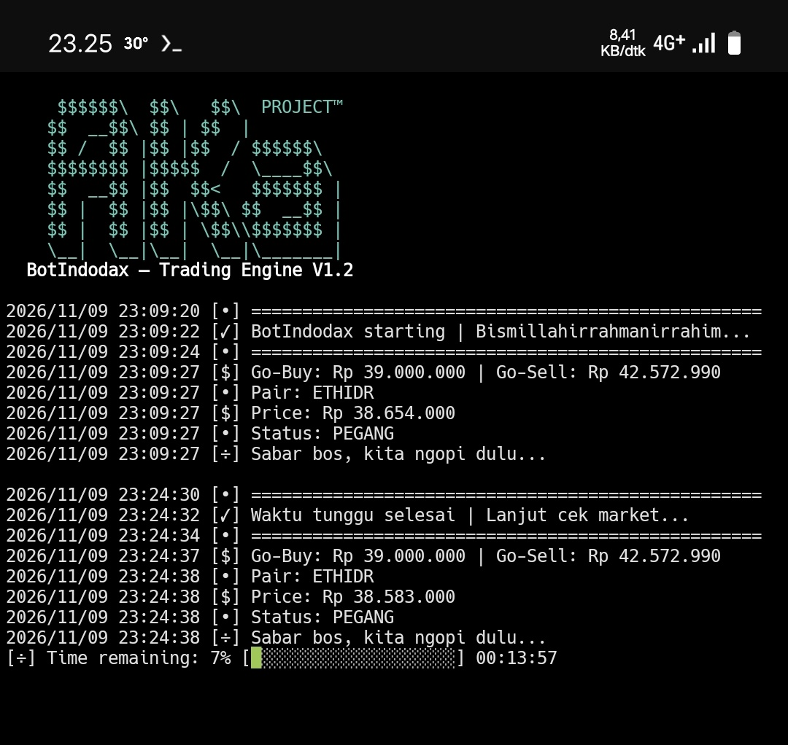

1| <p align="center">
2|   <a href="https://go.dev/"></a>
3|   <a href="https://termux.dev/"></a>
4|   <a href="LICENSE"></a>
5|   <a href="https://saweria.co/AKaAturDompet"></a>
6| </p>
7| 
8| # BotIndodax
9| 
10| Bot trading otomatis Indodax berbasis Go untuk Android melalui Termux. Bot memantau satu pair IDR dan mengirim order **market** sesuai trigger harga serta status posisi lokal.
11| 
12| > [!WARNING]
13| > Disclaimer: BotIndodax adalah alat otomatisasi trading yang dapat mengirim order nyata ke akun Indodax Anda.
14| > Pengembang tidak bertanggung jawab atas kerugian finansial, saldo yang terpotong, kegagalan eksekusi, atau konsekuensi lain yang timbul dari penggunaan bot.
15| > Software ini disediakan "as is" tanpa jaminan, bukan saran investasi, dan tidak menjamin keuntungan.
16| > Gunakan hanya jika Anda memahami risiko, telah meninjau kode dan konfigurasi secara hati-hati, serta membatasi izin API key hanya pada yang benar-benar dibutuhkan.
17| 
18| > [!CAUTION]
19| > Bot dapat mengirim order nyata dan menggunakan saldo akun Anda.
20| > Trading memiliki risiko kerugian dan tidak menjamin keuntungan.
21| > Tinjau kode dan konfigurasi sebelum menjalankan.
22| > Gunakan API key dan secret secara hati-hati, hanya aktifkan izin yang benar-benar diperlukan.
23| > Do with your own risk (DWYOR).
24| 
25| ## Screenshot
26| 
27| <p align="center">
28|   
29| </p>
30| 
31| ## Fitur
32| 
33| - Membaca harga ticker dari endpoint publik Indodax dan saldo akun melalui API v2.
34| - Mengirim order market BUY saat status lokal `KOSONG` dan harga ticker sama dengan atau di bawah `buyTrigger`.
35| - Mengirim order market SELL saat status lokal `PEGANG` dan harga ticker sama dengan atau di atas `sellTrigger`.
36| - Menghitung nominal BUY dari `modalPerTrade`, memeriksa saldo IDR, dan membandingkan kuantitas dengan `minQty`.
37| - Menjual seluruh saldo aset tersedia untuk pair yang dipantau saat sinyal SELL terpenuhi.
38| - Menyimpan status posisi dan waktu transaksi terakhir dalam `state.json`.
39| - Menerapkan jeda transaksi berdasarkan `cooldownMs` dan membaca ulang `config.json` setiap iterasi.
40| - Menghentikan proses jika hasil pengiriman order tidak dapat dipastikan, agar order dapat diperiksa di akun sebelum bot dijalankan kembali.
41| 
42| ## Cara kerja dan batasan
43| 
44| - Bot hanya mengelola **satu pair IDR**.
45| - Status posisi yang digunakan adalah `KOSONG` dan `PEGANG`; status ini disimpan secara lokal dan bukan cerminan otomatis seluruh aktivitas akun.
46| - Pemeriksaan market dilakukan setiap 15 menit. Jika permintaan ticker gagal, bot menunggu 5 menit sebelum mencoba kembali. Jika konfigurasi tidak valid, bot mencoba lagi setelah 1 menit.
47| - Tidak ada pengaturan batas jumlah transaksi harian.
48| - Jika saldo akun tidak cocok dengan state lokal, periksa dan selaraskan kondisi akun sebelum melanjutkan.
49| - Jika permintaan order timeout atau konfirmasi tidak lengkap, periksa riwayat order dan saldo Indodax sebelum menjalankan ulang bot. Order mungkin sudah diterima.
50| 
51| ## Persyaratan
52| 
53| - Android dengan Termux dan koneksi internet.
54| - Go versi **1.27.3 atau lebih baru** (sesuai `go.mod`).
55| - Akun Indodax dengan API key TAPI v2 berizin baca dan spot trading. Jangan aktifkan izin `WITHDRAWAL`.
56| 
57| ## Instalasi
58| 
59| ```sh
60| pkg update
61| pkg upgrade
62| pkg install git golang
63| 
64| git clone https://github.com/MinatoAka/BotIndodax.git
65| cd BotIndodax
66| ```
67| 
68| ## Konfigurasi
69| 
70| Edit `config.json` di direktori repository. Ganti nilai placeholder dengan API key dan secret Anda:
71| 
72| ```sh
73| nano config.json
74| ```
75| 
76| Contoh format:
77| 
78| ```json
79| {
80|   "apiKey": "ISI_API_KEY_LO",
81|   "secretKey": "ISI_SECRET_KEY_LO",
82|   "pair": "ethidr",
83|   "buyTrigger": 33450000,
84|   "sellTrigger": 34453500,
85|   "modalPerTrade": 15000,
86|   "minQty": 0.0001,
87|   "cooldownMinutes": 15,
88|   "pollingInterval": 15
89| }
90| ```
91| 
92| | Field | Keterangan |
93| | --- | --- |
94| | `apiKey` | API key Indodax TAPI v2. Wajib diisi. |
95| | `secretKey` | Secret key pasangan API key. |
96| | `pair` | Pair IDR huruf kecil, misalnya `ethidr`. |
97| | `buyTrigger` | Harga pemicu BUY; harus berupa angka positif. |
98| | `sellTrigger` | Harga pemicu SELL; harus lebih besar dari `buyTrigger`. |
99| | `modalPerTrade` | Modal minimal yang digunakan untuk trading, dalam IDR. |
100| | `minQty` | Kuantitas aset minimum untuk order BUY. Sesuaikan dengan aturan pair. |
101| | `cooldownMinutes` | Jeda minimum setelah transaksi sukses, dalam menit.|
102| | `pollingInterval` | Interval siklus bot dijalankan ulang, dalam menit. |
103| 
104| Jangan commit atau membagikan kredensial asli. Jika API key atau secret terungkap, cabut key tersebut dan buat yang baru. Pair, trigger, modal, dan kuantitas juga divalidasi saat konfigurasi dibaca.
105| 
106| ## Build dan jalankan
107| 
108| Jalankan bot dari direktori repository agar `config.json` dan `state.json` ditemukan.
109| 
110| ```sh
111| go build -o bot .
112| ./bot
113| ```
114| 
115| Atau jalankan langsung:
116| 
117| ```sh
118| go run .
119| ```
120| 
121| Di Termux, perintah berikut dapat membantu mencegah perangkat tidur saat bot berjalan:
122| 
123| ```sh
124| termux-wake-lock
125| ```
126| 
127| Hentikan bot dengan `Ctrl+C`.
128| 
129| ## State dan pengujian
130| 
131| `state.json` dibuat saat runtime. Jika file belum ada, bot memulai dengan status `KOSONG`. File ini menyimpan status posisi dan waktu transaksi terakhir; jangan menghapus atau mengubahnya tanpa memahami konsekuensinya.
132| 
133| Jalankan pengujian lokal dengan:
134| 
135| ```sh
136| go test ./...
137| ```
138| 
139| Pengujian yang tersedia mencakup validasi konfigurasi, pembacaan dan penyimpanan state, izin file state, serta konsistensi query string. Test tersebut tidak mengirim order ke Indodax.
140| 
141| ## Struktur repository
142| 
143| ```text
144| BotIndodax/
145| ├── LICENSE
146| ├── README.md
147| ├── config.go
148| ├── config.json
149| ├── go.mod
149| ├── main.go
150| ├── market.go
151| ├── order.go
152| ├── utils.go
153| └── utils_test.go
154| ```
155| 
156| ## Dukungan
157| 
158| [♡ Dukung pengembangan via Saweria](https://saweria.co/AKaAturDompet)
159| 
160| ## Lisensi dan disclaimer
161| 
162| Proyek ini menggunakan [MIT License](LICENSE). Perangkat lunak disediakan apa adanya, tanpa jaminan, dan bukan nasihat investasi. Anda bertanggung jawab atas keamanan API key, konfigurasi, pemantauan akun, serta segala keputusan trading yang diambil.
163| 
164| ---
165| 
166| ### English summary
167| 
168| BotIndodax is a Go-based Indodax trading bot for Termux. It monitors one IDR pair and can submit real market BUY/SELL orders based on configured price triggers and locally stored position state.
| 